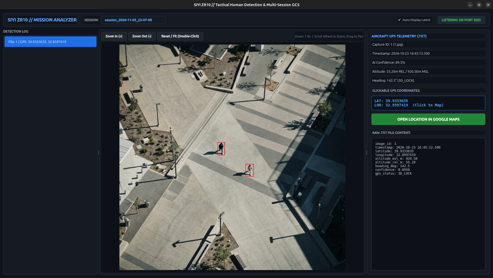

<p align="center">
  
</p>


# SIYI ZR10 Tactical GCS & Edge AI Telemetry Station

A high-reliability Ground Control Station (GCS) telemetry dashboard and real-time datalink ingestion pipeline engineered for unmanned aerial surveillance. Built using PyQt5 and Python socket architecture, the system provides real-time receiving, cryptographic verification, interactive inspection, and geo-referencing for aerial human detections captured via the SIYI ZR10 gimbal camera and NVIDIA DeepStream edge AI pipelines.

---

## Architecture Overview

The system operates across a low-latency air-to-ground pipeline designed for edge compute nodes (e.g., NVIDIA Jetson platforms) and mission control ground stations operating over the SIYI wireless datalink subnet (`192.168.144.0/24`).

1. **Airborne Edge Ingestion:**
   - DeepStream extracts native 1080p video frames from the SIYI ZR10 camera via RTSP (`rtsp://192.168.144.25:8554/main.264`).
   - High-confidence human detections trigger downscaled 640x640 JPEG exports and synchronized aircraft telemetry logs (`.txt`) extracted via MAVLink (`GLOBAL_POSITION_INT`).
   - Pairs are transmitted across TCP port 5055 with strict SHA-256 validation before permanent airborne inode deletion.

2. **Ground Control Station Dashboard (`gcs_tactical_station.py`):**
   - Implements a non-blocking TCP socket server bound to `0.0.0.0:5055` to ingest streaming image and telemetry payloads over Ethernet/Wi-Fi link bridges.
   - Manages organized multi-session mission directories partitioned by run timestamps.
   - Provides an interactive visual inspection canvas with dynamic zoom/pan transforms, target confidence scoring, aircraft spatial vectors, and one-click Google Maps coordinate projection.

---

## Core Features

- **Multi-Session Mission Tracking:** Automatically generates timestamped runtime directories (`gcs_mnm_data/session_YYYY-MM-DD_HH-MM-SS/`) on launch. Operators can dynamically review active or historical mission runs using the integrated session selector dropdown.
- **Fail-Safe TCP Transmission & Verification:** Ingests incoming `.jpg` and `.txt` payloads atomically using `.tmp` buffers. Computes and validates SHA-256 cryptographic hashes for both payloads before writing to disk and dispatching socket ACKs back to the airborne node.
- **Dynamic File System Synchronization:** Employs a debounced `QFileSystemWatcher` (150 ms) to monitor active session directories. The dashboard hot-reloads images and GPS data upon manual file modifications, renames, or deletions without freezing the main GUI thread.
- **High-Precision Image Canvas:** A GPU-accelerated `QGraphicsView` supporting smooth bilinear filtering (`SmoothPixmapTransform`), mouse-wheel-centric zoom (0.5x to 20.0x magnification), drag-to-pan inspection, and double-click aspect ratio resetting.
- **Geospatial & Telemetry Parsing:** Parses aircraft telemetry attributes from incoming `.txt` metadata:
  - Latitude, Longitude, Altitude (MSL & Relative), Heading, and GPS Lock Status.
  - Formats human detection confidence ratings.
  - Provides interactive, clickable coordinate buttons that directly launch external geospatial mapping views via Google Maps URL integration.
- **Resilient UI State Management:** Handles partial or missing data payloads gracefully. If telemetry files are missing or malformed, the visual feed continues running and disables mapping triggers rather than throwing runtime exceptions.

---

## Technology Stack

- **GUI Framework:** PyQt5 (QtWidgets, QtCore, QtGui)
- **Networking Protocol:** Custom TCP framing protocol with binary length prefixing and JSON metadata headers
- **Cryptographic Validation:** SHA-256 checksums (`hashlib`)
- **System Monitoring:** `QFileSystemWatcher` with debounced event processing
- **Target Platform:** Linux (Ubuntu 20.04/22.04 LTS), cross-platform compatible

---

## File Format & Telemetry Schema

Each detection event is committed to the active session folder under a synchronized identifier pair (`<id>.jpg` and `<id>.txt`):

```text
image_id: 1
timestamp: 2026-10-23 16:45:12.500
latitude: 39.9333635
longitude: 32.8597419
altitude_msl_m: 920.50
altitude_rel_m: 55.20
heading_deg: 142.5
confidence: 0.8950
gps_status: 3D_LOCK
```


## Installation & Setup

#### Prerequisites
- Python 3.8+
- PyQt5
```bash
pip install PyQt5
```


## Running the Station
#### Launch the Ground Control Station dashboard:
```bash
python3 gcs_tactical_station.py
```
- The application will bind to `port 5055`, create a new timestamped mission session directory inside `gcs_data/`, and await incoming datalink connections from the airborne transmitter.
