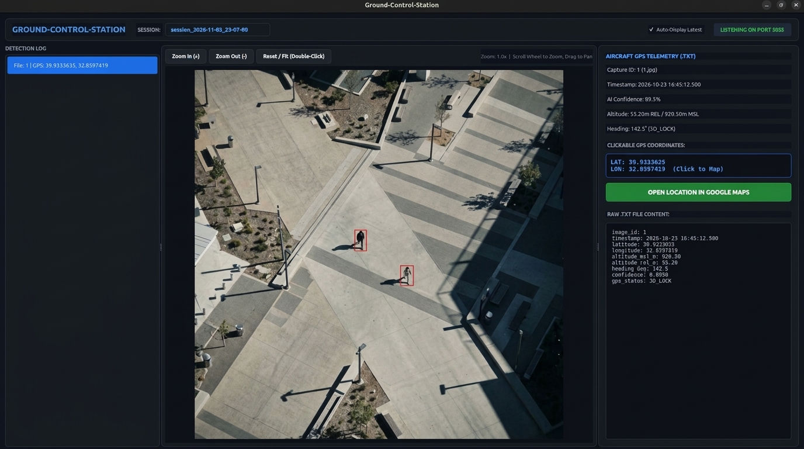

<p align="center">
  
</p>

<h1 align="center">Ground Control Station (GCS)</h1>

<p align="center">
  <strong>Provided by MNM</strong>
</p>

<p align="center">
  Real-time aerial imagery, GPS telemetry management, and mission visualization software for unmanned aerial operations.
</p>

<p align="center">
  
</p>

---

## Overview & Problem Solved

During unmanned aerial vehicle (UAV) flights, operators frequently face the challenge of receiving high-priority target imagery over wireless datalinks while keeping each captured frame accurately paired with its exact GPS position, altitude, and heading. Manually downloading, matching, and plotting scattered image files and flight logs wastes critical operational time.

**Ground Control Station (GCS)**, provided by **MNM**, solves this challenge by offering a unified, standalone desktop interface for **Windows** and **Ubuntu Linux**. It automatically captures incoming aerial imagery and telemetry in real time, verifies payload integrity, organizes every flight into timestamped mission sessions inside your local `Documents/GCS_MNM_Data` folder, and plots detections directly on an interactive map—eliminating manual post-flight data sorting.

---

## Where It Can Be Used

- **Search & Rescue (SAR) Operations:** Rapidly locate missing persons or vehicles with instant visual confirmation and exact GPS coordinates ready for ground response teams.
- **Aerial Surveillance & Perimeter Security:** Monitor restricted zones, borders, and critical infrastructure with real-time target alerts and persistent session logs.
- **Infrastructure & Industrial Inspection:** Capture, geo-tag, and review aerial images of power lines, pipelines, solar farms, and construction sites.
- **Environmental & Agricultural Monitoring:** Track wildlife, forest fire hotspots, or crop anomalies with organized, repeatable mission archives.
- **UAV Flight Testing & Research:** Evaluate onboard optical payloads, wireless datalink reliability, and detection accuracy during live flight trials.

---

## Key Capabilities

- **Real-Time Image & Telemetry Reception:** Automatically receives aerial images alongside aircraft latitude, longitude, MSL/relative altitude, heading, GPS lock status, and timestamps over a wireless datalink.
- **Interactive Image Inspection:** Smooth zoom, pan, and auto-fit viewing tools to inspect distant targets in full detail.
- **Live Map & Geographical Positioning:** Links every captured image directly to its geographical coordinates with built-in map visualization.
- **End-to-End Data Integrity:** Automatically validates incoming transmissions so corrupted or incomplete files are never logged.
- **Organized Local Storage (`Documents/GCS_MNM_Data`):** Automatically creates dedicated, timestamped mission folders inside your user `Documents/GCS_MNM_Data` directory, keeping all received images and telemetry records safely organized without overwriting past flights.
- **Live Synchronization & Post-Flight Review:** Updates the interface immediately as new detections arrive and allows operators to browse historical mission sessions at any time.
- **Standalone Cross-Platform Deployment:** Available as ready-to-run native installers for both **Windows (`.exe`)** and **Ubuntu Linux (`.deb`)**—no manual environment setup required.

---

## Standardized Mission Data Format

Every recorded event is saved inside the active mission directory under `Documents/GCS_MNM_Data/` as a synchronized image and telemetry pair (`<id>.jpg` and `<id>.txt`) for straightforward integration with external GIS and reporting workflows:

```text
image_id: 1
timestamp: 2026-10-23 16:45:12.500
latitude: 39.9333635
longitude: 32.8597419
altitude_msl_m: 920.50
altitude_rel_m: 55.20
heading_deg: 142.5
confidence: 0.8950
gps_status: 3D_LOCK